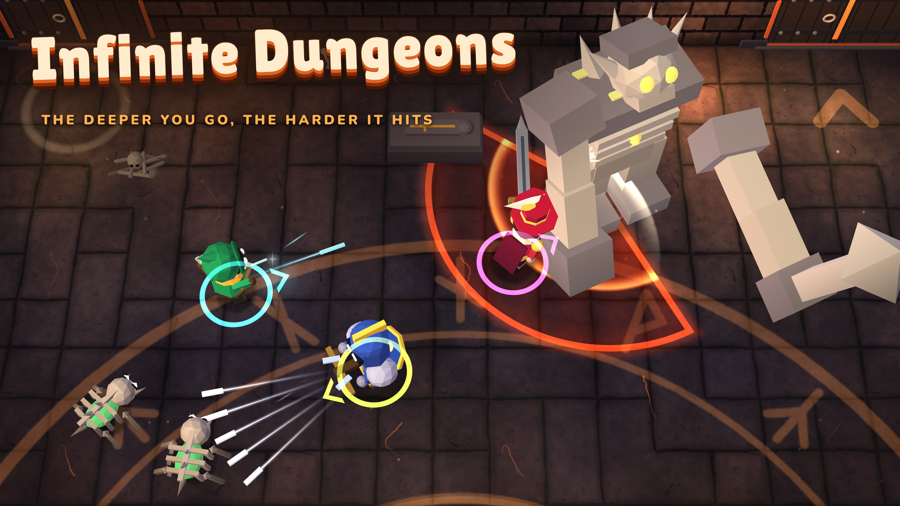

# Infinite Dungeons

Head down a bottomless dungeon with your friends, through the Smoldering Crypt and the lava and furnaces of The Sunken Forge: smash skeletons and forge brutes, grab rarer and rarer weapons, bring down the Bone Colossus, the Ossuary Warden and The Forgemaster, then choose between leaving with your loot or going deeper.

- Up to 4 players on one screen, with keyboard, mouse or controllers, or solo with AI companions.
- Runs in the browser. `index.html` is the whole game in one file: open it and play.
- In English, and fully in French too (Options, Language).
- The Sunken Forge is a content pack, on by default. To play the crypt alone, switch it off in Options, under Packs.

Designed and programmed by Claude, Anthropic's AI model. The Sunken Forge pack, and the engine pieces it needed, were built by Codex, an AI coding agent, from Claude's brief and reviewed by Claude.

## Licence and credits

- The code is under the MIT License (`LICENSE`).
- The music was made with Suno and ElevenLabs, and the sound effects with ElevenLabs or synthesized by the game from recipes. They keep their own rights and are not covered by the MIT License.
- The fonts Lilita One and Nunito are under the SIL Open Font License 1.1, and three.js is under the MIT License (`licences/`).

Details per track and per font are in `CREDITS.md`.
